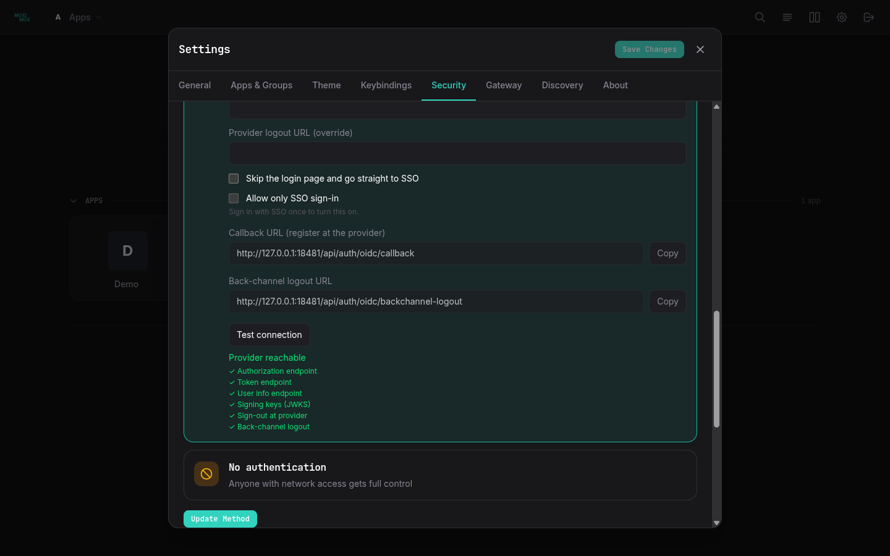
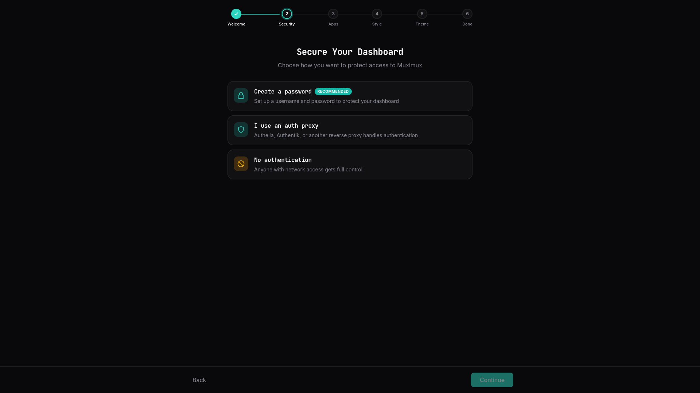

# Authentication

## Overview

Muximux supports four authentication methods, configured via `auth.method` in `config.yaml`:

| Method | Description |
|--------|-------------|
| `none` | No authentication (default) |
| `builtin` | Username/password login managed by Muximux |
| `forward_auth` | Delegates to an external auth proxy (Authelia, Authentik, etc.) |
| `oidc` | OpenID Connect with an identity provider (Keycloak, Auth0, Okta, etc.) |

The default is `none`.

---

## No Authentication

```yaml
auth:
  method: none
```

Anyone who can reach Muximux can use it. This suits trusted networks. It also suits setups where something outside Muximux already handles authentication (e.g., VPN-only access).

---

## Built-in Authentication

Username/password login with bcrypt-hashed passwords (passwords stored in a one-way scrambled form) and cookie-based sessions.

```yaml
auth:
  method: builtin
  session_max_age: 24h        # How long sessions last (default: 24h)
  secure_cookies: true         # Set true if serving over HTTPS
  api_key_hash: "$2a$12$..."    # Optional: bcrypt hash of API key (see below)
  users:
    - username: admin
      password_hash: "$2a$12$..."  # bcrypt hash
      role: admin
      email: admin@example.com     # Optional
      display_name: "Admin User"   # Optional
    - username: viewer
      password_hash: "$2a$12$..."
      role: user
```

### Generating Password Hashes

Use the built-in `hash` subcommand:

```bash
muximux hash
```

This prompts for a password (the input is hidden). It then prints a bcrypt hash that you paste into `config.yaml`.

You can also pass the value as an argument (useful for scripting):

```bash
muximux hash 'my-secret-password'
```

Alternatively, use any bcrypt tool:

```bash
# Using htpasswd (from apache2-utils)
htpasswd -nbBC 12 "" 'my-secret-password' | cut -d: -f2

# Using Python
python3 -c "import bcrypt; print(bcrypt.hashpw(b'my-secret-password', bcrypt.gensalt()).decode())"
```

### Roles

- **`admin`** -- Full access. Can modify settings, manage apps, groups, themes, icons, and users.
- **`power-user`** -- Extended dashboard access. Can view and interact with apps with elevated permissions but cannot manage users or change security settings.
- **`user`** -- Dashboard access. Can view and interact with apps but cannot change configuration.

### Sessions

- Cookie-based (cookie name: `muximux_session`)
- Automatically refreshed on activity
- Can be invalidated by changing the user's password (all other sessions for that user are invalidated)
- `session_max_age` accepts duration strings like `1h`, `24h`, `7d`

---

## Forward Auth (Authelia / Authentik / Traefik Forward Auth)

Use this method behind a reverse proxy (a server that forwards requests to Muximux) that handles authentication. Muximux reads the user's identity from HTTP headers that the auth proxy sets.

```yaml
auth:
  method: forward_auth
  trusted_proxies:
    - 192.168.0.0/16
    - 172.16.0.0/12
    - 10.0.0.0/8
  headers:
    user: Remote-User        # Header containing username (default: Remote-User)
    email: Remote-Email      # Header containing email (default: Remote-Email)
    groups: Remote-Groups    # Header containing groups (default: Remote-Groups)
    name: Remote-Name        # Header containing display name (default: Remote-Name)
  logout_url: https://auth.example.com/logout  # Optional: redirect here on sign-out
```

> **IMPORTANT:** `trusted_proxies` is required. If no trusted proxies are configured, Muximux rejects all forward auth requests. This stops users from spoofing auth headers by connecting directly.

Muximux checks only the IP of the direct TCP connection (from `RemoteAddr`) against trusted proxies. It does **not** trust forwarded headers like `X-Forwarded-For` for this check.

### Logout URL

When `logout_url` is set, a click on "Logout" in Muximux clears the local session **and** redirects the browser to the auth provider's logout endpoint. Without this setting, the user's external session stays valid. The user is then silently signed in again on the next page load.

#### Provider-specific examples

**Authelia:**

```yaml
logout_url: https://auth.example.com/logout
```

**Authentik:**

```yaml
# For proxy outpost (forward auth mode):
logout_url: https://app.example.com/outpost.goauthentik.io/sign_out

# For domain-level outpost:
logout_url: https://auth.example.com/outpost.goauthentik.io/sign_out
```

**Caddy Security (caddy-security plugin):**

```yaml
logout_url: https://auth.example.com/logout
```

**Traefik Forward Auth (thomseddon/traefik-forward-auth):**

```yaml
logout_url: https://auth.example.com/_oauth/logout
```

**Organizr:**

```yaml
logout_url: https://organizr.example.com/api/v2/logout
```

If your provider is not listed, check its documentation for the logout or sign-out endpoint URL.

### Admin Detection

Muximux automatically gives the admin role to users whose groups contain "admin", "admins" or "administrators". The match is case-insensitive.

To use a different group name, set `forward_auth_admin_groups` on the `auth` block. When set, it replaces the default list. Group matching stays case-insensitive.

```yaml
auth:
  method: forward_auth
  forward_auth_admin_groups:
    - dashboard-admins
```

You can also edit the admin groups in Settings -> Security. Muximux keeps them when you save other forward-auth settings.

### Direct Access Behavior

When forward auth is enabled, Muximux does not show a login form. Some users reach Muximux without being authenticated, for example by opening the internal IP directly instead of going through the reverse proxy. These users see a message that explains that an external provider handles authentication.

A username/password form would only confuse people here. Forward auth delegates all authentication to the reverse proxy, so there are no local credentials to enter.

### Typical Setup with Authelia

Your reverse proxy (Nginx, Traefik, Caddy) authenticates users through Authelia. It then forwards the request to Muximux with identity headers. Muximux reads these headers and creates a session.

---

## OIDC (OpenID Connect)

Direct integration with identity providers like Authentik, Keycloak, Auth0, Okta, and others.

### Setting up OIDC in Settings

You can configure single sign-on from the UI instead of editing `config.yaml`. Open **Settings > Security** and choose the **Single sign-on (OIDC)** card.

[](https://raw.githubusercontent.com/mescon/Muximux/main/docs/screenshots/19-security-oidc.png)

1. Enter the **issuer URL** (the address of your identity provider), **client ID** and **client secret**.
2. Adjust the **scopes** (space-separated) if your provider needs more than the defaults.
3. Set the claims that Muximux reads: username, email, display name and groups. Claims are the fields of user data that the provider sends.
4. Enter **admin groups** as a comma-separated list.
5. Copy the two read-only rows into your provider with their **Copy** buttons. **Callback URL (register at the provider)** is the redirect URL to register. It is your override if you set one, otherwise `<origin><base path>/api/auth/oidc/callback`. **Back-channel logout URL** is where the provider sends logout notifications. The optional callback URL override is for setups where Muximux cannot work out its public address.
6. Press **Test connection**. Muximux fetches the issuer's discovery document (the provider's published list of its endpoints and features). It reports whether the provider is reachable, and which of these it offers: authorization, token, userinfo and JWKS endpoints, sign-out at the provider (`end_session_endpoint`), and back-channel logout. The test only follows `http` and `https`, and times out after 10 seconds. It reads at most 1 MB, and follows redirects only within the same host (at most 10). Private and LAN addresses are allowed.
7. Press **Update Method**. Muximux checks the provider through discovery before it saves anything. If that check fails, nothing changes and Muximux shows the error. On success, Muximux writes the settings to `config.yaml`. They take effect immediately, without a restart. Once it succeeds the change is already saved.

The sign-out options are the same as in the YAML: also sign out at the provider, the return address after provider sign-out, and a provider logout URL override. **Skip the login page** sets `auto_redirect` and **Allow only SSO sign-in** sets `disable_local_login`.

**Client secret.** The secret is never shown. Leave the field empty to keep the stored secret. Type a value to replace it.

**Fields from environment variables.** Some fields are set by a `MUXIMUX_OIDC_*` variable, or have a `config.yaml` value of exactly `${VAR}`. Settings shows these fields locked, with "Set by VAR", and never changes them. Their text fields are read-only and their checkboxes are disabled. The server keeps the environment's value, even if a request sends another one. The secret's value stays hidden even then. Change those values in the environment. When `MUXIMUX_AUTH_METHOD` is set, the method cards other than the current one are disabled as well. See [Configuring OIDC with environment variables](#configuring-oidc-with-environment-variables).

**Allow only SSO sign-in.** This setting has two guards, so that you cannot lock yourself out:

- You can turn it on only from a session that signed in through SSO. Otherwise the checkbox is disabled, and the server answers 409 "sign in with SSO once before turning off local login".
- While it is on, the issuer, client ID and secret are locked. The server answers 409 "turn off SSO-only sign-in before changing the identity provider". To change providers:
  1. Turn SSO-only off.
  2. Press **Update Method**.
  3. Change the provider.
  4. Press **Update Method** again.
  5. Sign in with SSO.
  6. Turn SSO-only on again.

If the provider is down and you are locked out, recover by editing `config.yaml` as described under [SSO-only sign-in](#sso-only-sign-in).

**Switching and existing sessions.** Switching from OIDC to another method sets `enabled: false`. It keeps the OIDC settings in the file, so switching back needs no retyping. User management stays visible with OIDC while local sign-in is still allowed. Existing sessions stay valid when you change the method or the provider. But sign-ins that were in progress on the old provider fail, and the user must retry them. If two admins save at once, the last save wins, as with other settings.

### Setting up OIDC in config.yaml

The YAML below is the alternative and produces the same configuration.

```yaml
auth:
  method: oidc
  oidc:
    enabled: true
    issuer_url: https://auth.example.com     # OIDC discovery endpoint base
    client_id: muximux
    client_secret: ${OIDC_CLIENT_SECRET}      # Supports env var expansion
    redirect_url: https://muximux.example.com/api/auth/oidc/callback
    scopes:                                   # Default: [openid, profile, email]
      - openid
      - profile
      - email
    username_claim: preferred_username         # Default: preferred_username
    email_claim: email                        # Default: email
    groups_claim: groups                       # Default: groups
    display_name_claim: name                  # Default: name
    admin_groups:                             # Groups that grant admin role
      - admins
      - muximux-admins
    # provider_logout: false                  # End the session at the provider on logout
    # post_logout_redirect_url: ""            # Where the provider sends the browser after logout
    # logout_url: ""                          # End-session URL for providers without one in discovery
    # auto_redirect: false                    # Skip the login page and go straight to SSO
    # disable_local_login: false              # Refuse username/password sign-in
```

### How It Works

1. User clicks "Login with SSO" on the login page.
2. The browser redirects to the OIDC provider's login page.
3. After authentication, the provider redirects back to Muximux's callback URL.
4. Muximux exchanges the authorization code for tokens.
5. Muximux fetches user info from the provider's userinfo endpoint.
6. Muximux creates a local session.

### Setting Up Your OIDC Provider

- Create a new application/client in your provider.
- Set the redirect/callback URL to: `https://your-muximux-domain/api/auth/oidc/callback`
- Note the client ID and client secret.
- The issuer URL is usually the base URL of your provider (e.g., `https://auth.example.com/application/o/muximux/` for Authentik).

For step-by-step instructions tailored to a specific provider, including how to surface group memberships so `admin_groups` matches:

- **[Microsoft Entra ID](oidc-microsoft-entra-id)** (formerly Azure AD)
- **[Keycloak](oidc-keycloak)**
- **[Authentik](oidc-authentik)**
- **[Pocket ID](oidc-pocket-id)** -- minimal self-hosted IdP with passkey sign-in
- **[Zitadel](oidc-zitadel)** -- self-hosted IdP with project roles as groups
- **[Google](oidc-google)** (consumer + Workspace; no group support)
- **[Authelia](forward-auth-authelia)** (forward auth or OIDC)
- **[Cloudflare Access](forward-auth-cloudflare-access)** -- Cloudflare Zero Trust as forward auth

### Signing out at the provider

By default, logging out of Muximux ends only the Muximux session. The provider's own session stays open. So a new click on "Login with SSO" signs the user straight back in. Set `provider_logout: true` to also end the session at the provider:

```yaml
auth:
  oidc:
    provider_logout: true
    post_logout_redirect_url: https://muximux.example.com/login?logged_out=1   # Optional
    # logout_url: https://auth.example.com/logout                              # Optional
```

- On logout, a session created through OIDC sends the browser to the provider's end-session endpoint. The request carries `id_token_hint`, `client_id`, `post_logout_redirect_uri` and `state`. A local (username/password) session never does this.
- `post_logout_redirect_url` is where the provider returns the browser. The default is the origin of `redirect_url`, plus the base path, plus `/login?logged_out=1`. For example: `https://muximux.example.com/login?logged_out=1`. **Register this address at your provider**, or the provider will refuse the return. It must be an absolute `http` or `https` URL.
- `logout_url` overrides the end-session address. Use it for providers that do not list an `end_session_endpoint` in their discovery document. It must be an absolute `http` or `https` URL.
- If no end-session address is known, logout stays local.

### SSO-only sign-in

- `auto_redirect: true` makes the login page go straight to the provider. It does not do so in three cases: right after logout (`?logged_out=1`), after a failed sign-in (`?error=...`), or when you open `/login?local=1`. That last address reaches the local form when local login is allowed.
- `disable_local_login: true` refuses password sign-in (HTTP 403) and hides the form on the login page. API keys keep working, and `?local=1` does not bypass it. It applies only while OIDC is enabled. With OIDC turned off, the username and password form works as before.

If sign-in at the provider fails or is cancelled, Muximux sends the browser back to the login page. The page gets a short code and shows a message. The codes are: `oidc_denied` when the user cancelled at the provider, `oidc_state` when the sign-in request expired or was already used (for example after pressing Back), and `oidc_failed` for anything else. The details are in the Muximux log, not in the URL.

If the provider is down and you are locked out, set `disable_local_login: false` in `config.yaml` and restart Muximux.

### Back-channel logout

When a user signs out at the provider, the provider can tell Muximux. Muximux then ends that user's sessions too. Enter this address as the back-channel logout URL in your provider:

```
https://muximux.example.com/api/auth/oidc/backchannel-logout
```

(Include your base path if Muximux is served under one.) The endpoint is always on when OIDC is enabled. There is nothing to configure in Muximux. It accepts a POST with a `logout_token` form field. It checks the signature (against the provider's JWKS, its published signing keys), the issuer and the audience. It also checks the back-channel logout event claim, and that no nonce is present. Finally, it checks that the token was issued at most 10 minutes ago, and that its `jti` has not been seen before. Muximux matches sessions by the token's `sid`, or by `sub` when there is no `sid`. Muximux holds sessions in memory, so a restart signs everyone out.

Each provider guide has a **Sign-out** section with the provider's field names.

### Configuring OIDC with environment variables

Every OIDC setting, and the auth method itself, can come from environment variables instead of `config.yaml`. A fresh container can have no `config.yaml`, only these variables and a Docker secret. Such a container starts with OIDC as its auth method and skips the setup wizard. Redeploying with the same variables gives the same configuration.

| Variable | Setting | Value |
|---|---|---|
| `MUXIMUX_AUTH_METHOD` | `auth.method` | `none`, `builtin`, `forward_auth` or `oidc` |
| `MUXIMUX_OIDC_ENABLED` | `auth.oidc.enabled` | boolean |
| `MUXIMUX_OIDC_ISSUER_URL` | `issuer_url` | URL |
| `MUXIMUX_OIDC_CLIENT_ID` or `MUXIMUX_OIDC_CLIENT_ID_FILE` | `client_id` | string, or the path of a file holding it |
| `MUXIMUX_OIDC_CLIENT_SECRET` or `MUXIMUX_OIDC_CLIENT_SECRET_FILE` | `client_secret` | string, or the path of a file holding it |
| `MUXIMUX_OIDC_REDIRECT_URL` | `redirect_url` | absolute `http(s)` URL |
| `MUXIMUX_OIDC_SCOPES` | `scopes` | list, separated by commas and/or spaces |
| `MUXIMUX_OIDC_USERNAME_CLAIM` | `username_claim` | string |
| `MUXIMUX_OIDC_EMAIL_CLAIM` | `email_claim` | string |
| `MUXIMUX_OIDC_GROUPS_CLAIM` | `groups_claim` | string |
| `MUXIMUX_OIDC_DISPLAY_NAME_CLAIM` | `display_name_claim` | string |
| `MUXIMUX_OIDC_ADMIN_GROUPS` | `admin_groups` | list, separated by commas (group names may contain spaces) |
| `MUXIMUX_OIDC_PROVIDER_LOGOUT` | `provider_logout` | boolean |
| `MUXIMUX_OIDC_POST_LOGOUT_REDIRECT_URL` | `post_logout_redirect_url` | absolute `http(s)` URL |
| `MUXIMUX_OIDC_LOGOUT_URL` | `logout_url` | absolute `http(s)` URL |
| `MUXIMUX_OIDC_AUTO_REDIRECT` | `auto_redirect` | boolean |
| `MUXIMUX_OIDC_DISABLE_LOCAL_LOGIN` | `disable_local_login` | boolean |

Booleans accept `true`, `1`, `yes`, `on` and `false`, `0`, `no`, `off`. An empty or blank variable counts as unset. So a blank entry in a compose file never clears a value. Unset scopes and claims use the provider defaults listed under [Setting up OIDC in config.yaml](#setting-up-oidc-in-configyaml). `MUXIMUX_AUTH_METHOD=oidc` also turns `enabled` on. So you only need `MUXIMUX_OIDC_ENABLED` to turn it off (for example with another method).

A minimal setup:

```bash
MUXIMUX_AUTH_METHOD=oidc
MUXIMUX_OIDC_ISSUER_URL=https://auth.example.com/application/o/muximux/
MUXIMUX_OIDC_CLIENT_ID=muximux
MUXIMUX_OIDC_CLIENT_SECRET_FILE=/run/secrets/muximux_oidc_secret
MUXIMUX_OIDC_REDIRECT_URL=https://muximux.example.com/api/auth/oidc/callback
MUXIMUX_OIDC_ADMIN_GROUPS=muximux-admins
```

Without local users, the login page still shows a password form, which cannot succeed. Add `MUXIMUX_OIDC_DISABLE_LOCAL_LOGIN=true` to hide it. Also add `MUXIMUX_OIDC_AUTO_REDIRECT=true` to go straight to the provider.

[Deployment](deployment.md#oidc-from-environment-variables-and-docker-secrets) has complete Docker Compose and Docker Swarm examples with secrets.

**Docker secrets (`_FILE`).** `MUXIMUX_OIDC_CLIENT_ID_FILE` and `MUXIMUX_OIDC_CLIENT_SECRET_FILE` name a file to read the value from, such as `/run/secrets/muximux_oidc_secret`. Muximux removes only trailing line breaks (`\n` or `\r\n`). Anything else in the file is part of the value. These are errors: setting both `X` and `X_FILE`, or a file that is missing, unreadable, empty or larger than 64 KiB. The error names the variable and the path, never the file's content. Settings shows such a field as "Set by MUXIMUX_OIDC_CLIENT_SECRET_FILE".

**Precedence.** An environment variable (`X` or `X_FILE`) wins over `config.yaml`, including a `${VAR}` reference there. `config.yaml` wins over the built-in defaults.

**Memory only.** Muximux applies values from these variables when it starts. It does not write them to `config.yaml`. The one exception is the method that a completed setup wizard saves (see below). Saving from Settings writes the file's own values. So if you remove a variable later, the next start brings back what `config.yaml` says. While a variable is set, its field is locked in Settings, and the API does not change it. `PUT /api/auth/method` keeps the environment's OIDC values. It refuses these with 409:

- a method change while `MUXIMUX_AUTH_METHOD` is set (re-saving the same method to edit other fields is fine);
- choosing OIDC while `MUXIMUX_OIDC_ENABLED=false`;
- leaving OIDC while OIDC variables are set without `MUXIMUX_AUTH_METHOD`.

`GET /api/config` (`env_overrides`) and `GET /api/auth/settings/oidc` (`env_fields`) name the variables but never carry their values. The client secret is never returned.

**Startup checks (fail closed).** Muximux refuses to start, with an error naming the variable, when:

- `MUXIMUX_AUTH_METHOD` has an unknown value;
- a variable that configures OIDC sign-in (`MUXIMUX_OIDC_ENABLED=true`, `MUXIMUX_OIDC_ISSUER_URL`, `MUXIMUX_OIDC_CLIENT_ID(_FILE)`, `MUXIMUX_OIDC_CLIENT_SECRET(_FILE)` or `MUXIMUX_OIDC_REDIRECT_URL`) is set, `MUXIMUX_AUTH_METHOD` is not, and `config.yaml` does not already say `method: oidc`. Set `MUXIMUX_AUTH_METHOD=oidc`, or remove the OIDC variables. Tuning variables (scopes, claims, logout options) and `MUXIMUX_OIDC_ENABLED=false` do not trigger this;
- the method is `oidc` and `MUXIMUX_OIDC_ENABLED=false`;
- a `_FILE` variable cannot be used (see above);
- OIDC is configured from the environment and the issuer URL is missing or not an absolute `http(s)` URL, or the client ID is missing;
- a URL variable is not an absolute `http(s)` URL. The error reads, for example, `MUXIMUX_OIDC_REDIRECT_URL (auth.oidc.redirect_url) must be an absolute http(s) URL`.

An invalid boolean only logs a warning, and Muximux keeps the `config.yaml` value. Muximux also logs a warning for a `MUXIMUX_OIDC_*` name that it does not know (a typo such as `MUXIMUX_OIDC_CLIENT_SECERT`). The warning names the variable. OIDC variables have no effect while `MUXIMUX_AUTH_METHOD` is `none` or `forward_auth`, or `builtin` without OIDC enabled. In that case Muximux still starts, and logs one warning that names them. Muximux logs these warnings once, at startup. With `MUXIMUX_AUTH_METHOD=oidc`, no admin groups and no local admin user, a warning says that nobody will be an admin.

**Setup wizard.** With `MUXIMUX_AUTH_METHOD` set to `oidc`, `forward_auth` or `none`, the instance starts configured. There is no setup wizard and no setup token. No variable sets the forward auth options. So with `forward_auth`, put `trusted_proxies` in `config.yaml`. Also put `headers` there if your proxy does not use the defaults. See [Forward Auth](#forward-auth-authelia--authentik--traefik-forward-auth). Without `trusted_proxies`, every request is rejected. With `builtin` and no users in `config.yaml`, the wizard still runs, so that you can create the first admin. Its security step is locked to password sign-in. The setup endpoint refuses any other method with 409. Completing the wizard writes `method: builtin` and the new admin to `config.yaml`. This is the one case where Muximux saves the method from the environment. So if you remove the variable later, a password is still required.

**Export.** **Export Config** in **Settings > General** (`GET /api/config/export`) writes the live configuration. So values from the environment appear in the backup like any other setting. Client secrets are blanked, as for every export, whether they came from `config.yaml` or the environment. After you restore such a backup on a host without the variables, enter the secret again.

**Removing `MUXIMUX_AUTH_METHOD` later.** On the next start, the method then comes from `config.yaml` again. On an instance that was configured only through the environment, that is usually `none`. The exception is when the setup wizard ran under `MUXIMUX_AUTH_METHOD=builtin`, which saves `method: builtin`. Two cases:

- If OIDC variables such as `MUXIMUX_OIDC_ISSUER_URL` are still set, Muximux refuses to start (see above). To fix this, put `MUXIMUX_AUTH_METHOD` back, set `auth.method: oidc` in `config.yaml`, or remove the OIDC variables as well.
- If you also removed all OIDC variables, and the instance has apps, it starts **without authentication**. Before you remove the variables, choose the method you want in `config.yaml` (for example `auth.method: builtin` with a user, see [Built-in Authentication](#built-in-authentication)).

If the provider is down and SSO-only sign-in locks you out:

1. Set `MUXIMUX_OIDC_DISABLE_LOCAL_LOGIN` to `false`. If you only remove the variable, the `config.yaml` value applies again, and that value can also be `true`.
2. Make sure `config.yaml` has a local admin user.
3. Restart Muximux.

### `${VAR}` references in config.yaml

Use `${VAR_NAME}` syntax in `config.yaml` to reference environment variables. This is useful for secrets:

```yaml
client_secret: ${OIDC_CLIENT_SECRET}
```

References stay in the file when you save from Settings. So secrets kept in the environment are not written out in plain text. A value that you change in Settings replaces its reference. A value with a reference can sit inside a flow-style list or map, such as `[a, ${B}]`. If it does, Muximux cannot track the references in that file, and saves expand them as before.

---

## Per-App Group Filtering

`min_role` gates an app on the user's role tier (admin > power-user > user). For finer control, you can also restrict an app to specific **groups** that the user belongs to.

```yaml
apps:
  - name: Internal Wiki
    url: http://wiki.internal:8080
    proxy: true
    allowed_groups: [staff, contractors]   # only users in one of these groups see the app

  - name: Production Console
    url: http://prod.internal
    proxy: true
    min_role: admin                         # role gate
    allowed_groups: [sre, on-call]          # AND group gate

  - name: Status Page
    url: http://status.internal
    proxy: true
    # No allowed_groups -> visible to anyone who clears min_role (default behavior)
```

Rules:

- `allowed_groups` empty or missing -> no group gate. Existing configs keep working.
- `allowed_groups` set -> the user needs to be in **at least one** of those groups to see and reach the app.
- `min_role` and `allowed_groups` are additive. If both are set, both must match.
- Group names are matched **case-insensitive**, so `Developers` and `developers` both work.
- **Admins always see every app**, regardless of `allowed_groups`. This mirrors how the role hierarchy bypasses `min_role`.

### Where users get groups

| Auth method | Source of group memberships |
|---|---|
| **Built-in (password)** | The optional `groups: [...]` field on each user in `auth.users[]`, editable via Settings -> Security -> Users. |
| **OIDC** | The configured `groups_claim` (default `groups`) on each sign-in. Group membership is owned by your IdP (identity provider). |
| **Forward auth** | The `Remote-Groups` header (configurable via `auth.headers.groups`). Group membership is owned by your auth proxy. |

For OIDC and forward-auth users, group membership refreshes when they log in again. Changes on the IdP side during a session do not apply until the user signs in again.

### Configuring built-in users

In `config.yaml`:

```yaml
auth:
  method: builtin
  users:
    - username: alice
      password_hash: "$2a$12$..."
      role: user
      groups:
        - developers
        - on-call
    - username: bob
      password_hash: "$2a$12$..."
      role: user
      # No groups -> only sees apps with no allowed_groups gate
```

Or use the UI:

1. Open **Settings -> Security -> Users**.
2. Type a comma-separated list in the **Groups** field next to the user's role.

The change saves when you leave the field.

### Configuring OIDC / forward-auth groups

OIDC users get their groups from their IdP claim, so the work happens on the IdP side. See the per-provider guides for the exact configuration needed:

- [Microsoft Entra ID](oidc-microsoft-entra-id) -- emit Security Group display names in the `groups` claim
- [Keycloak](oidc-keycloak) -- add a Group Membership mapper, full path off
- [Authentik](oidc-authentik) -- enable the `groups` scope and property mapping
- [Pocket ID](oidc-pocket-id) -- assign users to groups in the admin UI
- [Zitadel](oidc-zitadel) -- create project roles, point `groups_claim` at `urn:zitadel:iam:org:project:roles`
- [Authelia](forward-auth-authelia) -- groups arrive via `Remote-Groups` (forward auth) or the `groups` claim (OIDC)

If you restore a backup whose OIDC provider cannot be reached, Muximux clears the OIDC provider. OIDC login then stays off until you fix the issuer in Settings -> Security.

### What if a user has no groups?

A user with no groups passes the role gate, but fails any non-empty `allowed_groups` gate. So apps without `allowed_groups` stay visible, and apps with `allowed_groups` become invisible. This is intentional. A misconfigured IdP claim then defaults to "no access" rather than "access to everything". That is the safer failure.

---

## API Key Authentication

Muximux supports an instance-wide API key. Non-browser integrations (scripts, webhooks, other services) can present it in the `X-Api-Key` header instead of a session cookie. The key lets a tool like Seerr or a cron job reach Muximux without keeping a logged-in session.

The API key is not a universal bypass. It only authenticates requests on **allowlisted** paths. These are the built-in ones listed below, plus any proxied-app paths that you add with `require_api_key: true`. Everything else that needs a login still requires a session cookie. So a leaked key can only reach those paths. (A few endpoints, such as `GET /api/auth/status` and `GET /api/health`, need no credentials at all.)

### Where the API Key Works

Out of the box, these paths accept `X-Api-Key`:

| Path | What it's for |
|---|---|
| `GET /api/appearance` | Embedded / external apps fetching Muximux's current language and theme (see [Apps > Appearance API](apps.md#appearance-api)). |

Operators can also allowlist **per-app proxy paths** through `auth_bypass` on each proxied app. This is the common integration pattern. You expose a backend app's own API (e.g. Sonarr's `/api/v3/*`) through the Muximux reverse proxy. The Muximux API key gates it at the front door. See [Apps > Per-App Auth Bypass](apps.md#per-app-auth-bypass) for the full setup.

#### Example 1: Seerr calling Sonarr through Muximux

```yaml
apps:
  - name: Sonarr
    url: http://sonarr:8989
    proxy: true
    # Muximux -> Sonarr: Sonarr's own auth (so the user doesn't see it)
    proxy_headers:
      X-Api-Key: "${SONARR_API_KEY}"
    # Caller -> Muximux: require the Muximux API key on /api/*
    auth_bypass:
      - path: /api/*
        methods: [GET, POST]
        require_api_key: true
```

Seerr calls:

```bash
curl -H "X-Api-Key: $MUXIMUX_API_KEY" \
  https://muximux.example.com/proxy/sonarr/api/v3/series
```

Muximux validates the Muximux key at the front door. It then forwards the request to Sonarr, with Sonarr's own API key added as a header. Each key covers one hop: `proxy_headers` replaces the caller's `X-Api-Key`, so Sonarr only ever sees its own key.

#### Example 2: GitHub webhook hitting a proxied app

Say you run a self-hosted CI tool behind Muximux at `/proxy/ci/`. You want GitHub to POST to its webhook receiver. GitHub does not have a Muximux session cookie and never will. So without an `auth_bypass` rule, the request gets a 401.

Configure the proxied app to accept the Muximux API key on the exact webhook path:

```yaml
apps:
  - name: CI
    url: http://ci.internal:8080
    proxy: true
    # Caller -> Muximux: only the webhook path, only POST, only with the API key.
    auth_bypass:
      - path: /hooks/github      # relative to the app: /proxy/ci/hooks/github
        methods: [POST]
        require_api_key: true
```

In GitHub, configure the webhook with:

- **Payload URL:** `https://muximux.example.com/proxy/ci/hooks/github`
- **Content type:** `application/json`
- **Secret:** GitHub's HMAC secret, if you use one. This is independent of the Muximux key. It passes through the proxy as the standard `X-Hub-Signature-256` header.
- **Custom header:** `X-Api-Key: <your Muximux API key>`. (GitHub's webhook UI does not let you add arbitrary headers. So you typically run the webhook through a small relay that adds the header. Other services like Linear, Sentry, Tailscale, or n8n let you set custom headers directly.)

Then the request flow is:

1. External service POSTs to `https://muximux.example.com/proxy/ci/hooks/github` with `X-Api-Key`.
2. Muximux's `auth_bypass` matches `/proxy/ci/hooks/github` + `POST` + `require_api_key: true`. Muximux verifies the bcrypt hash, and lets the request through without a session cookie.
3. Muximux's reverse proxy forwards the request to `http://ci.internal:8080/hooks/github`. The original payload, `X-Hub-Signature-256` and other app-specific headers pass through unchanged.
4. The CI tool processes the webhook normally.

Scope is tight by design: this rule allows only `POST /proxy/ci/hooks/github`. The same key cannot reach `GET /proxy/ci/admin`, or any other `/api/*` endpoint that has not been allowlisted.

> **Header note:** When a rule with `require_api_key: true` lets a request through, Muximux removes the Muximux key (`X-Api-Key`) before forwarding. So a backend never receives the instance-wide key. If the proxied app wants its own `X-Api-Key` (Sonarr, Radarr, Prowlarr, Lidarr, Bazarr all do), set `proxy_headers.X-Api-Key: "<backend-key>"` on the app. Requests that pass with a session cookie instead keep whatever `X-Api-Key` the caller sent.

### What the API Key Does NOT Unlock

The following endpoints **always** require a session cookie (logged-in user). Sending `X-Api-Key` to them has no effect. The request still gets a 401:

- `GET /api/config`, `PUT /api/config` (dashboard configuration)
- `GET/POST /api/apps`, `GET/POST /api/groups` (app and group CRUD)
- `GET/POST /api/themes` (theme CRUD)
- `GET/POST/DELETE /api/auth/users` (user management)
- `POST /api/auth/password` (password change)
- Every other `/api/*` path not explicitly listed above

This is deliberate. A session cookie is attributable to a specific user in audit logs. It is `HttpOnly`, so JavaScript cannot read it. It also expires on its own. A bearer token (a key that works for anyone who holds it), like an API key, has none of these properties. So it does not get to drive state-changing administrative endpoints.

### How It Works

Muximux stores the API key as a **bcrypt hash** in `config.yaml`, not as plaintext. When a request arrives with `X-Api-Key`, Muximux verifies it against the stored hash with `bcrypt.CompareHashAndPassword`. This means:

- The original API key cannot be recovered from the config file
- If `config.yaml` is compromised, the attacker cannot extract the key
- Verification is constant-time, preventing timing attacks

### Generating an API Key

**Recommended: in the UI.**

1. Open **Settings → Security → API Key** as an admin.
2. Click **Generate API key**.

Muximux uses 32 bytes of `crypto/rand`. It prefixes the result with `muximux_`, so that a leaked key is recognisable. It stores only the bcrypt hash on disk. Muximux shows the plaintext exactly once, so that you can copy it into your integration. If you lose it, click **Rotate** to generate a new one. **Delete** clears the configured key. After that, every allowlisted path immediately stops accepting `X-Api-Key`.

**Alternative: command line.** If you want to set a key that you generated yourself, hash it first. Then write the hash into `config.yaml`:

```bash
# Using the built-in hash subcommand
muximux hash 'my-api-key'

# Using htpasswd
htpasswd -nbBC 12 "" 'my-api-key' | cut -d: -f2
```

```yaml
auth:
  method: builtin
  api_key_hash: "$2a$12$..."
```

Restart Muximux, and the key is live. From then on, the UI reports the key as configured and offers Rotate / Delete.

### Operational Guidance

- **Keep the key out of browser code.** `X-Api-Key` is a bearer token: anyone who sees it can authenticate as that key. Put it on server-side integrations, not in JavaScript that untrusted users load.
- **Rotating the key** invalidates every integration at once, because there is only one `api_key_hash` per instance. Coordinate the swap.
- **Disable the key** by removing `api_key_hash` from config (or clearing it in the UI). Every allowlisted path immediately stops accepting `X-Api-Key`.
- **Audit logs** for API-key requests show a sentinel user (a fixed placeholder, not a human username). If you need per-integration attribution, use separate proxied apps with their own `auth_bypass` rules.

---

## What Authentication Protects

Muximux authentication controls access to the **Muximux dashboard and its API**. It does not automatically protect the apps that you add to it. Be aware of three configurations:

- **With `proxy: true`, no `auth_bypass`** -- Requests to the app go through Muximux's built-in reverse proxy, which requires a Muximux login session. Users must be logged in to reach the app. This is the secure option for interactive use. This applies only when an authentication method is set. With `auth.method: none`, the proxy lets every request through without a login.

- **With `proxy: true` and `auth_bypass` rules** -- You can open specific paths on the proxied app to non-browser integrations. A rule with `require_api_key: true` lets a request through only if it presents the Muximux API key. A rule without `require_api_key: true` lets every matching request through with no session and no API key. Only the rule's `allowed_ips` list, if set, limits it. See [Per-App Auth Bypass](apps.md#per-app-auth-bypass) and the Sonarr / Seerr example in [API Key Authentication](#api-key-authentication). Muximux still sits in the request path. The Muximux API key gates the front door. `proxy_headers` adds the backend's own credentials on the way through, so the external caller never sees the backend's key. This is how you expose a backend API to another service without giving that service a Muximux login.

- **Without `proxy: true`** -- The browser loads the app directly from its own URL (in an iframe, new tab, etc.). Muximux is not in the request path. It cannot block or authenticate those requests. Anyone who knows the app's URL can access it directly.

In short: if you expose Muximux to the internet and want it to gate access to your apps, set an authentication method and enable the reverse proxy for those apps. If other services need to call a backend app's API through Muximux, add an `auth_bypass` rule with `require_api_key: true`. Limit that rule to the specific paths that those services need. Otherwise, secure your apps with their own authentication, a separate reverse proxy or a VPN.

Muximux only protects requests that go through it. If the backend is also reachable directly (a published port, a shared network), anyone who reaches it there skips Muximux. So block direct access to the backend from untrusted networks, or turn on the backend's own authentication.

See [Apps & Groups > Open Modes](apps.md#open-modes) for more details on the three-way choice and [Per-App Auth Bypass](apps.md#per-app-auth-bypass) for the integration pattern.

---

## First-Run Setup

When Muximux starts with no configuration, the onboarding wizard includes a **Security** step. In this step you configure authentication before anything else. You can choose password authentication, forward auth or no authentication. That way the dashboard is secured from the first launch.

If authentication is already configured (or you run behind an auth proxy), the wizard skips the security step. It goes directly to app setup.

When `MUXIMUX_AUTH_METHOD` is set, the wizard is skipped entirely. The exception is `builtin` with no users: then the security step only offers password sign-in. See [Configuring OIDC with environment variables](#configuring-oidc-with-environment-variables).

### Setup Token

An attacker on the same network could race the legitimate operator through the onboarding wizard. To stop this, Muximux generates a one-time **setup token** (a secret code) on first boot. The wizard (and the restore-from-backup flow) refuse to proceed without it. The token is only required during initial setup. Once setup completes, Muximux destroys it.

You can find the token in two ways:

- **Container/console output.** At first boot, Muximux prints a line tagged with the token to stdout. You can read it, for example, with `docker logs muximux` or in the systemd journal. Look for `Generated new setup token` or `Reusing existing setup token`. The second one appears on restarts that happen before setup is complete. Muximux prints the token to the console only. It never writes it to `muximux.log` or shows it in the in-app log viewer. If an older release left the token in `muximux.log`, Muximux issues a new token at startup and prints that one instead.
- **Filesystem.** Muximux also writes the token to `<dataDir>/.setup-token` with mode `0600`. On a default Docker deployment, that is `/app/data/.setup-token` inside the container.

Paste the token into the **Setup token** field on the onboarding wizard's welcome screen. The wizard sends it as an `X-Setup-Token` HTTP header on the underlying setup and restore requests. Once setup is complete, Muximux removes the token file and no longer accepts the header. The setup endpoints reject every request after that point.

Until setup completes, the rest of the API waits. These parts answer `503 setup_required`: user and API key management, the auth method and OIDC settings, the log viewer, the live `/ws` stream and the `/proxy/` app routes. Only these stay open: sign-in, setup, restore, the health probe, and the theme and icon lists that the wizard uses. See [API Reference > Authentication](api.md#authentication).

[](https://raw.githubusercontent.com/mescon/Muximux/main/docs/screenshots/02-security.png)

---

## Managing Users

Admin users can manage accounts from **Settings > Security > User Management**:

- **Add users** -- Set a username, password (minimum 8 characters), and role
- **Change roles** -- Promote or demote users via the role dropdown
- **Delete users** -- Remove accounts (you cannot delete yourself or the last admin)

These changes take effect immediately, and Muximux saves them to `config.yaml`. You can also manage users through the [User Management API](api.md#user-management).

---

## Switching Auth Methods

Admin users can switch the authentication method from **Settings > Security** without restarting Muximux. The available options are:

- **Password authentication** -- Built-in username/password authentication
- **Auth proxy** -- Forward auth via Authelia, Authentik, etc. (requires trusted proxy IPs)
- **Single sign-on (OIDC)** -- Sign in through an OpenID Connect provider. Selecting the card opens the provider form. Muximux checks the provider before it applies the switch. See [Setting up OIDC in Settings](#setting-up-oidc-in-settings)
- **No authentication** -- No authentication

When you switch to a different method, Muximux keeps existing user accounts in the configuration. But they only authenticate when the method matches. For example, after a switch from `builtin` to `forward_auth`, password logins stop working. The user records stay in `config.yaml`, and they work again if you switch back.

You can also change the auth method through the [API](api.md#auth-method-switching).

While `MUXIMUX_AUTH_METHOD` is set, you cannot change the method here. The other cards are disabled, a note names the variable, and the API answers 409. Change the variable and restart instead. You can still edit the settings of the current method, for example the OIDC provider fields that no variable sets. Fields set by a `MUXIMUX_OIDC_*` variable are shown locked ("Set by ..."). Two other changes are refused the same way: choosing OIDC while `MUXIMUX_OIDC_ENABLED=false`, and leaving OIDC while OIDC variables are set without `MUXIMUX_AUTH_METHOD`. See [Configuring OIDC with environment variables](#configuring-oidc-with-environment-variables).

---

## Changing Passwords

Users can change their own password in **Settings > Security**, or with the `POST /api/auth/password` endpoint. Changing a password invalidates all other sessions for that user (except the current one).

**Password requirements:** minimum 8 characters.
