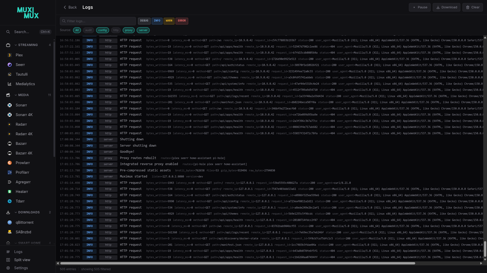

# Debug Logging

Muximux includes a debug logging system for both the **frontend** (browser console) and the **backend** (server logs). Both help you diagnose issues without modifying code or restarting the server.

---

## Frontend Debug Logging

### Enabling

Add `?debug=true` to your Muximux URL:

```
https://muximux.example.com/?debug=true
```

This writes a flag to your browser's `localStorage` (the browser's local storage for this site). So debug logging stays on across page reloads and navigation. You only need to add the query parameter once.

### Disabling

Go to:

```
https://muximux.example.com/?debug=false
```

Or manually remove the flag:

```js
localStorage.removeItem('muximux_debug');
```

> **Important:** Removing `?debug=true` from the URL does **not** turn off debug logging. The flag persists in localStorage until you explicitly disable it with `?debug=false`.

### What Gets Logged

All debug messages appear in the browser console under `console.debug()`. In most browsers, you must enable the "Verbose" log level in DevTools to see them.

Messages are prefixed with `[muximux:category]` for easy filtering:

| Category | What's Logged |
|---|---|
| `config` | Config loaded (app count, auth method, health interval), config updates via WebSocket |
| `ws` | WebSocket connect, connected, reconnect attempts, gave up, event types received |
| `auth` | Auth status check results, login success/failure |
| `theme` | Theme applied, custom CSS load failures |
| `health` | Health polling started, health data updates |
| `icon` | Image load failures for app icons |
| `keys` | Keyboard shortcut actions dispatched |

### Filtering in DevTools

In Chrome/Firefox DevTools, use the Console filter box to show only specific categories:

- Type `[muximux:ws]` to see only WebSocket messages
- Type `[muximux:` to see all Muximux debug messages
- Type `-[muximux:health]` to hide health polling noise

### Zero Overhead in Production

When debug logging is off (the default), each `debug()` call is a single true/false check that returns immediately. It does no string formatting, object serialization or console output. So the performance impact is effectively zero.

---

## Backend Debug Logging

### Enabling

In Settings > General, change the **Log Level** to `debug`. This takes effect immediately without a restart.

[](https://raw.githubusercontent.com/mescon/Muximux/main/docs/screenshots/13-logs.png)

Or set it in `config.yaml`:

```yaml
server:
  log_level: debug
```

Or override it with an environment variable. The variable takes precedence over the config file:

```bash
MUXIMUX_LOG_LEVEL=debug muximux
```

### What Gets Logged at Each Level

Some log sources are active at the default INFO level. Others only appear when you switch to DEBUG.

**Always active (INFO and above):**

| Source | What's Logged |
|---|---|
| `http` | API and page requests: method, path, status, latency, bytes written, remote IP, user agent |
| `audit` | Security events: login, logout, password changes, user management, config changes |
| `server` | Panic recovery with stack traces (logged at ERROR) |

**Debug level only (set log level to `debug` to see these):**

| Source | What's Logged |
|---|---|
| `http` | Static asset requests (`/assets/*`, `.js`, `.css`, images, fonts) -- suppressed at INFO to avoid noise |
| `auth` | Every request showing whether it was authenticated, bypassed, or rejected, including the matched user and request path |
| `health` | Individual health check results per app with response times |
| `proxy` | Route rebuilds when config changes |
| `websocket` | Client connect/disconnect events |

> **Tip:** At the default `info` level, you see one log line per API call -- not per CSS/JS/image load. Set `log_level: warn` to hide request logs entirely. Then you see only warnings and errors.

### Request ID Correlation

Muximux gives every HTTP request a `request_id`. The ID appears in all log entries for that request. So you can trace a single request across auth, handler, and proxy logs.

- If the request carries an `X-Request-ID` header (up to 128 ASCII letters, digits, `-` or `_`), Muximux reuses it. Muximux doesn't check that it is unique. That is up to whatever set it, usually your upstream proxy (Nginx, Traefik, Caddy). A client can send one too. Two requests with the same ID show up together when you filter by it
- Otherwise, Muximux generates a random 16-character hex ID
- Muximux always sets the `X-Request-ID` response header, so you can match browser requests to server logs

Filter logs by request ID in the log viewer to see the full lifecycle of a single request.

### Understanding Auth Bypass Messages

When debug logging is on, you see `Auth bypassed` messages for certain paths. This is **expected behavior**. These paths are static assets and endpoints that must be accessible without authentication:

| Path Pattern | Why It's Bypassed |
|---|---|
| `/assets/*` | SPA JavaScript and CSS bundles (needed to render the login page) |
| `/manifest.json` | PWA manifest |
| `/api/auth/status` | Checks if the user is logged in (must work before login) |
| `/themes/*.css` | Theme stylesheets (needed to style the login page) |
| `/favicon.ico`, `/apple-touch-icon.png` | Browser-requested icons |

All API endpoints that return user data (`/api/config`, `/api/apps/*`, etc.) require authentication. They show `Authenticated request` with the username.

---

## When to Use Debug Logging

### Troubleshooting Common Issues

| Problem | What to Enable | What to Look For |
|---|---|---|
| App not loading in iframe | Frontend (`?debug=true`) | `[muximux:config]` for app list, browser Network tab for 404s |
| WebSocket disconnections | Frontend | `[muximux:ws]` for reconnect attempts and "gave up" messages |
| Theme not applying | Frontend | `[muximux:theme]` for CSS load failures |
| Health status wrong | Backend (debug level) | `health` source for individual check results and response times |
| Auth issues | Backend (debug level) | `auth` source for bypass/reject/authenticate details per request |

### Sharing Debug Output

When reporting an issue:

1. Enable frontend debug logging (`?debug=true`)
2. Set backend log level to `debug`
3. Reproduce the problem
4. Copy the relevant console output and server logs
5. Include them in your bug report

Copy frontend logs from the browser's DevTools Console tab. Backend logs appear in the server's standard output and in `muximux.log` inside the data directory.

---

## Log Rotation

Muximux automatically rotates the `muximux.log` file (in the data directory), so that it does not fill the disk:

- When the log file reaches **10 MB**, Muximux rotates it
- Muximux keeps up to **3** rotated copies (`muximux.log.1`, `muximux.log.2`, `muximux.log.3`)
- Muximux automatically deletes older rotated files

No external log rotation tool (e.g., `logrotate`) is needed.

On restart, Muximux reloads the most recent log entries into the in-memory buffer. So the **/logs** page shows history from before the restart.

---

## Privacy

- Frontend debug logs are written only to your browser's console. They are not sent to any server.
- The `localStorage` flag (`muximux_debug`) contains only the value `"1"` and no personal data.
- Backend debug logs may include usernames and request paths. Be mindful of this when sharing logs publicly.
