# Getting Started

This page walks you through what happens the first time you launch Muximux and how to get your dashboard up and running.

---

## First Launch

Muximux can start before it is set up. Then it shows the **Onboarding Wizard**, a guided setup for the initial configuration. Setup is pending when no `data/config.yaml` exists. It is also pending when the file has no apps, no users and no auth method other than `none`, and the wizard has not completed before. The `MUXIMUX_AUTH_METHOD` environment variable changes this. With `oidc`, `forward_auth` or `none`, there is no wizard. With `builtin`, the wizard runs only when there are no users. See [Authentication](authentication.md).

Open your browser and go to Muximux (by default, `http://your-server:8080`).

---

## Onboarding Wizard

The wizard has six steps. One of them is a **Security** step, where you choose your authentication method. With `MUXIMUX_AUTH_METHOD=builtin`, this step offers only password sign-in. You can move forward and backward between steps at any time.

### Step 1: Welcome

A brief introduction to Muximux and its core features: embedded app views via iframes (frames that show another web page inside this page), health monitoring, and keyboard-driven navigation. Click **Let's Get Started** to begin.

[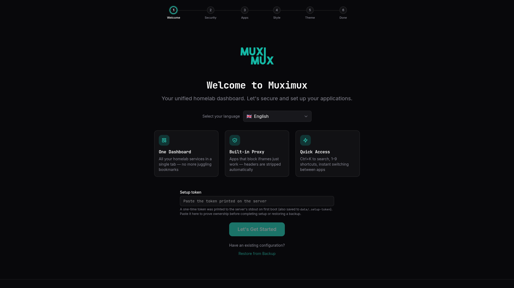](https://raw.githubusercontent.com/mescon/Muximux/main/docs/screenshots/01-welcome.png)

### Step 2: Security (fresh install only)

On a fresh install with no authentication configured, the wizard includes a Security step. Here you choose how users sign in:

- **Password** -- Create an admin account with a username and password. This uses Muximux's built-in authentication.
- **Forward Auth** -- Use an external authentication proxy (Authelia, Authentik, etc.). You must give at least one trusted proxy CIDR range (a block of IP addresses).
- **None** -- Disable authentication entirely. Anyone who can reach Muximux has full access.

This step only appears during initial setup. After setup, you can change authentication settings in Settings. This includes single sign-on (OIDC), which you set up under Settings > Security. See [Authentication](authentication#setting-up-oidc-in-settings).

### Step 3: Apps & Groups

This step uses a two-column layout (single column on mobile):

**Left column** -- At the top, an opt-in **Have Docker?** card lets you turn on Docker discovery during onboarding. To use it:

1. Tick the box.
2. Confirm the Docker endpoint. The default is the standard unix socket.
3. Pick a network strategy.

When onboarding completes, Muximux saves the discovery config. Then **Settings → Discovery** is ready to scan and import. The wizard itself does not run the scan. The scan happens after onboarding, so that you can review what gets imported.

Below the Docker card, browse popular self-hosted application templates organized by category:

- **Media** -- Plex, Jellyfin, Emby, Tautulli, Seerr, Navidrome
- **Downloads** -- Sonarr, Radarr, Lidarr, Prowlarr, qBittorrent, SABnzbd, NZBGet, Transmission, Deluge
- **System** -- Portainer, Proxmox, Unraid, TrueNAS, Home Assistant, Pi-hole, AdGuard Home, Nginx Proxy Manager, Traefik, Grafana, Prometheus, Uptime Kuma
- **Utilities** -- Vaultwarden, Nextcloud, Photoprism, Immich, Paperless-ngx, Gitea, Code Server, Syncthing, Mealie, Bookstack

Click on any app to select it. A URL field appears. Enter the actual address of that service in your network (e.g., change `http://localhost:32400/web` to `http://192.168.1.50:32400/web`).

The **Add Custom App** card is at the top of the left column. Click it to expand a form. In the form, give a name, URL, icon (from the icon browser), color, and group. The group dropdown lists existing groups plus a "No Group" option.

**Right column** -- Shows your current selections:

- **Selected Apps** -- A live list of all selected template and custom apps, each with a remove button.
- **Groups** -- Auto-populated based on the categories of your selected apps. You can edit each group:
  - **Color** -- Click the color swatch to open a color picker.
  - **Icon** -- Click the icon area to open the icon browser and choose from Dashboard Icons, Lucide icons, or custom uploads.
  - **Name** -- Edit the group name inline.
  - **Delete** -- Remove a group with the X button.
  - **Add Group** -- Click "+ Add Group" to create a new group from scratch.

[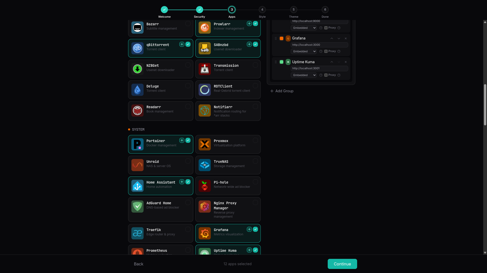](https://raw.githubusercontent.com/mescon/Muximux/main/docs/screenshots/04-apps-selected.png)

### Step 4: Navigation Style

Choose how the navigation bar appears in your dashboard:

| Position | Description |
|----------|-------------|
| **Top Bar** | Horizontal navigation across the top of the page |
| **Left Sidebar** | Vertical sidebar on the left side |
| **Right Sidebar** | Vertical sidebar on the right side |
| **Bottom Bar** | Horizontal navigation across the bottom of the page |
| **Floating** | Floating action button with popover panel |

You can also toggle **Show App Labels** to control whether app names are displayed alongside their icons in the navigation.

| Left Sidebar | Top Bar | Bottom Bar |
|:---:|:---:|:---:|
| [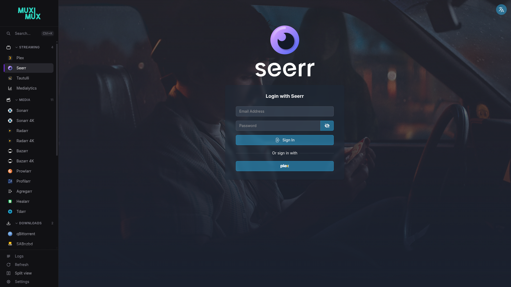](https://raw.githubusercontent.com/mescon/Muximux/main/docs/screenshots/05-style.png) | [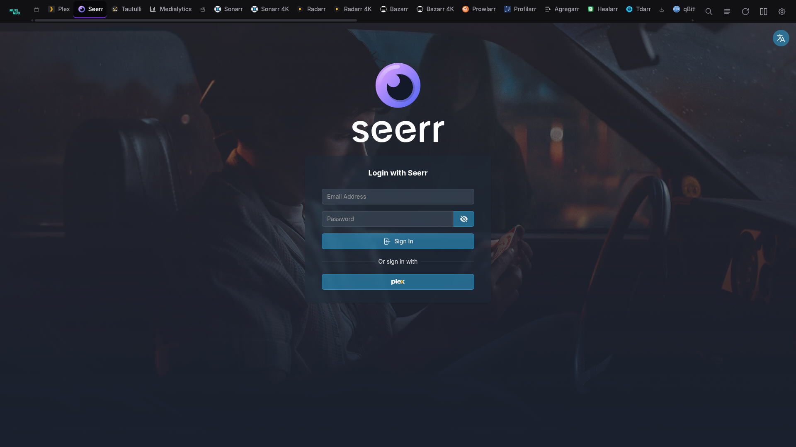](https://raw.githubusercontent.com/mescon/Muximux/main/docs/screenshots/05a-style-top.png) | [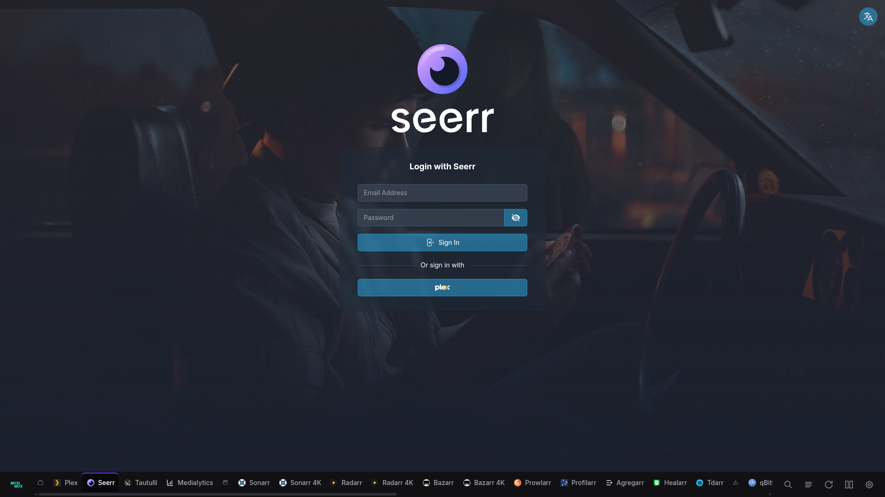](https://raw.githubusercontent.com/mescon/Muximux/main/docs/screenshots/05b-style-bottom.png) |

| Floating | Right Sidebar |
|:---:|:---:|
| [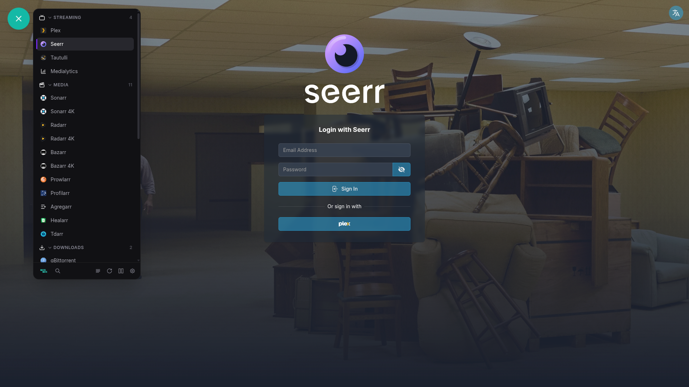](https://raw.githubusercontent.com/mescon/Muximux/main/docs/screenshots/05c-style-floating.png) | [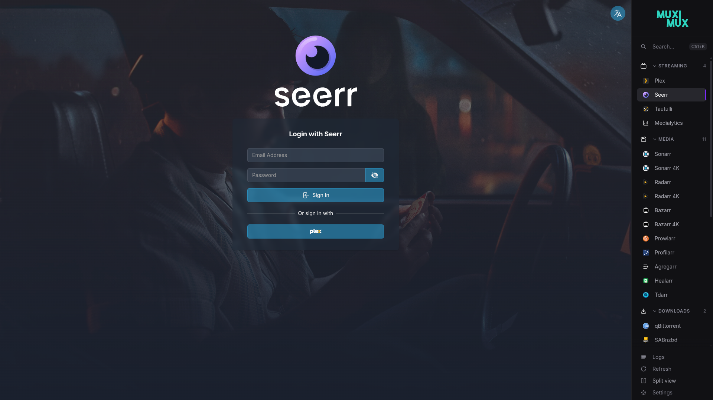](https://raw.githubusercontent.com/mescon/Muximux/main/docs/screenshots/05d-style-right.png) |

### Step 5: Theme

Choose a visual theme for your dashboard:

- Use the **variant selector** (Dark / System / Light) to control whether to follow the OS preference or force a specific mode.
- Browse available **theme families** in a grid. Each card shows color swatches for background, surface, and accent colors. Click a family to select it.
- Changes apply **live** -- the wizard background shows the new theme as you click.

You can create custom themes later in Settings. Muximux saves the selected theme to `config.yaml` as part of the server-side configuration.

| Muximux (Default) | Catppuccin | Dracula |
|:---:|:---:|:---:|
| [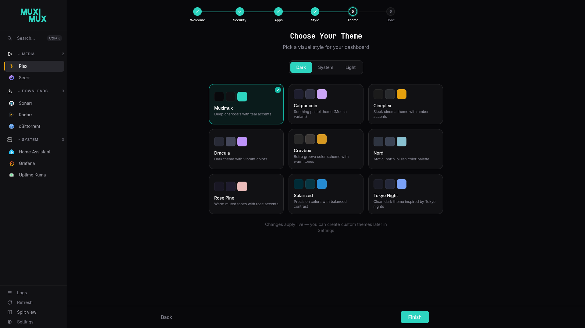](https://raw.githubusercontent.com/mescon/Muximux/main/docs/screenshots/06-theme-dark.png) | [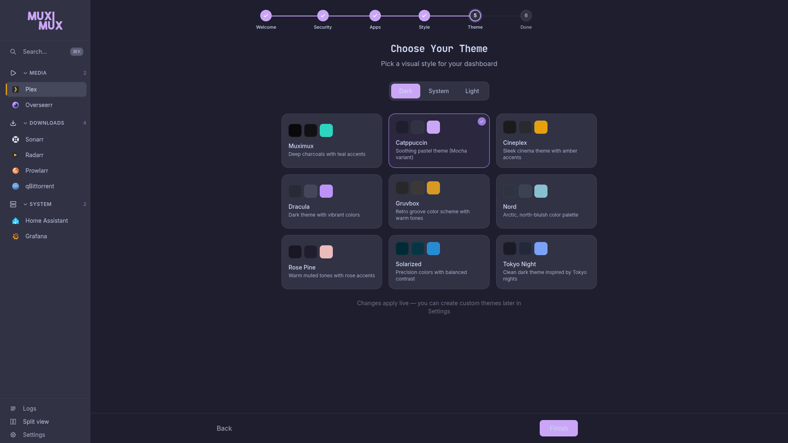](https://raw.githubusercontent.com/mescon/Muximux/main/docs/screenshots/06b-theme-catppuccin.png) | [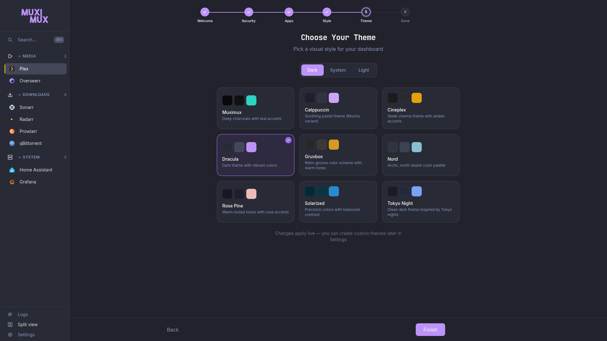](https://raw.githubusercontent.com/mescon/Muximux/main/docs/screenshots/06c-theme-dracula.png) |

### Step 6: Complete

Muximux shows a summary of your choices: number of apps, navigation position, theme family, number of groups, and label visibility. Click **Launch Dashboard** to apply the configuration and open your new dashboard.

[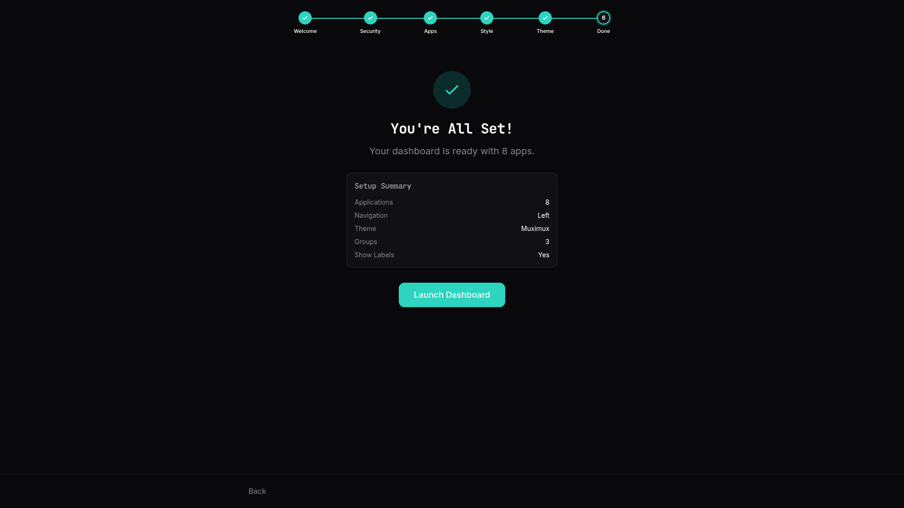](https://raw.githubusercontent.com/mescon/Muximux/main/docs/screenshots/08-done.png)

---

## Restore from Backup

You can have an existing `config.yaml` backup (e.g. from a previous Muximux install or from the **Export Config** button in Settings). Then you can restore it directly from the welcome screen, instead of going through the wizard.

1. On the welcome page, enter the one-time **Setup token**. See [Authentication > First-Run Setup](authentication.md#first-run-setup) for where to find it.
2. Click **Restore from Backup** below the "Let's Get Started" button.
3. Select your `.yaml` file.

Muximux validates the config, saves it, and reloads. It skips the entire wizard.

---

## After Onboarding

Once the wizard completes:

- Your configuration is saved to `data/config.yaml`.
- The first app in your list is automatically set as the **default app**, which loads when you open the dashboard.
- **Health monitoring** is available but off by default. Enable it per-app in Settings, or for many apps at once in the Apps tab. When it is on, Muximux checks each app at the configured interval (default: every 30 seconds).
- Muximux records in `config.yaml` that setup is complete (`auth.setup_complete: true`). The onboarding wizard does not appear again, also when you remove all apps.

You can open **Settings** at any time from the navigation bar to modify apps, groups, navigation style, themes, and all other options.

---

## Resetting Muximux

To completely start fresh and see the onboarding wizard again:

1. **Stop Muximux** (or the container).
2. **Delete or rename** the `data/config.yaml` file (or the config file in your configured data directory).
3. **Start Muximux** again.

The onboarding wizard appears automatically, because setup is pending again. You do not need to clear any browser state.

---

## Quick Manual Setup

You can skip the onboarding wizard entirely. To do this, create a `data/config.yaml` by hand before you start Muximux. Here is a minimal example:

```yaml
server:
  listen: ":8080"
  title: "My Dashboard"

navigation:
  position: "left"
  show_labels: true

theme:
  family: "default"
  variant: "system"

health:
  enabled: true
  interval: "30s"
  timeout: "5s"

apps:
  - name: "Portainer"
    url: "http://192.168.1.10:9000"
    icon:
      type: "dashboard"
      name: "portainer"
    color: "#13BEF9"
    group: "System"
    order: 0
    enabled: true
    default: true
    open_mode: "iframe"
    proxy: false
    scale: 1

  - name: "Plex"
    url: "http://192.168.1.10:32400/web"
    icon:
      type: "dashboard"
      name: "plex"
    color: "#E5A00D"
    group: "Media"
    order: 1
    enabled: true
    default: false
    open_mode: "iframe"
    proxy: false
    scale: 1

groups:
  - name: "System"
    icon:
      type: "lucide"
      name: "server"
    color: "#F46800"
    order: 0
    expanded: true

  - name: "Media"
    icon:
      type: "lucide"
      name: "play"
    color: "#E5A00D"
    order: 1
    expanded: true
```

See the [Configuration Reference](configuration.md) for a complete description of every available option.
