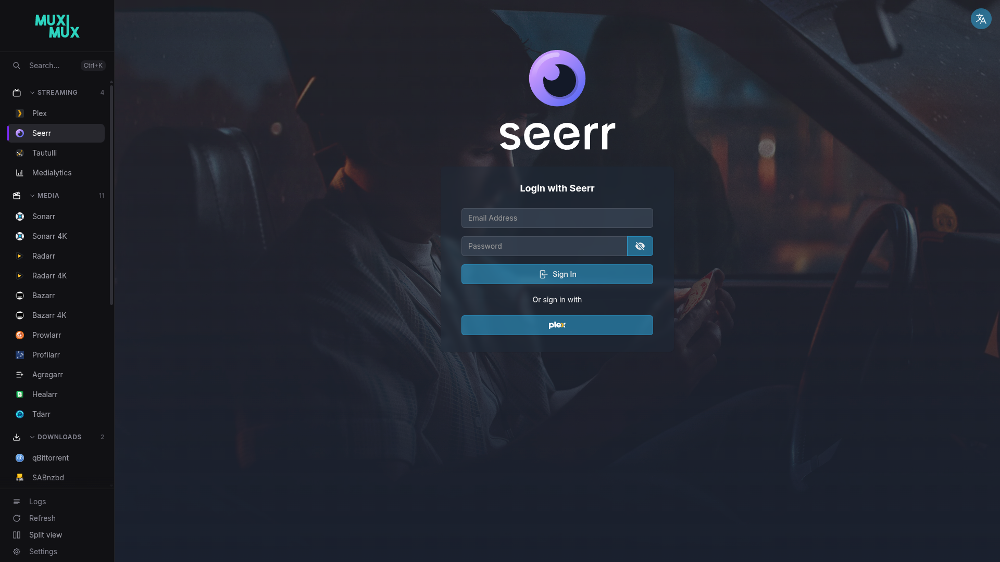
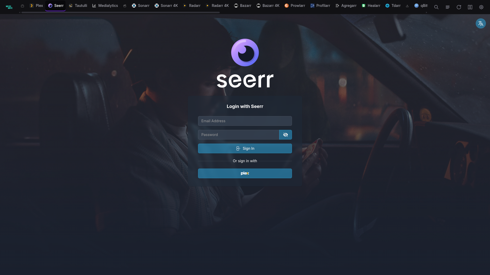
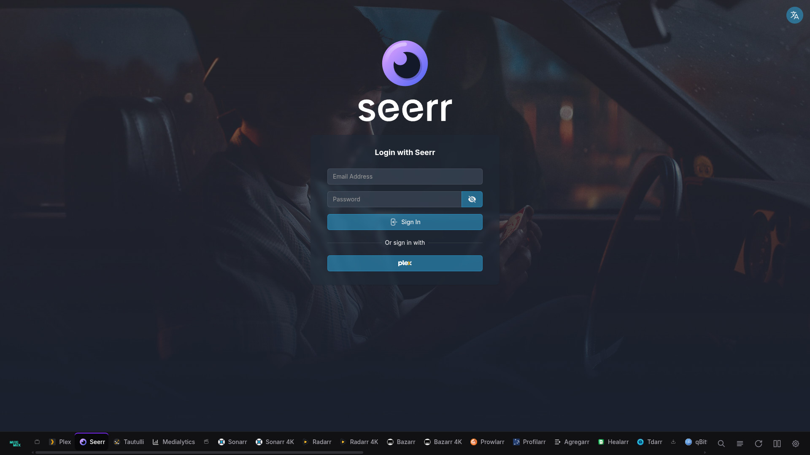
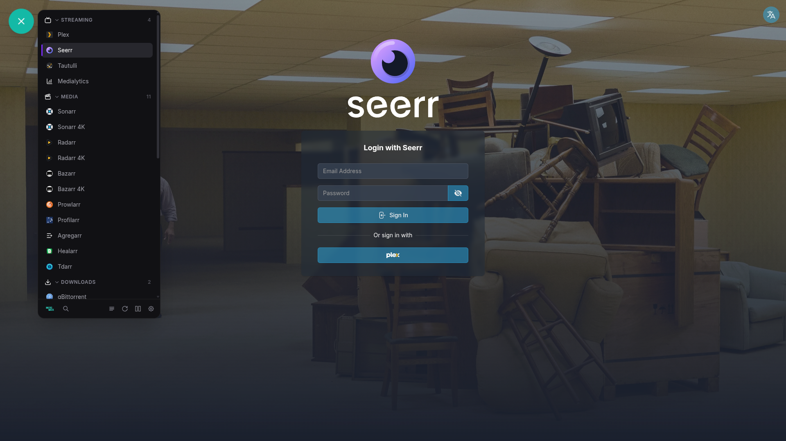
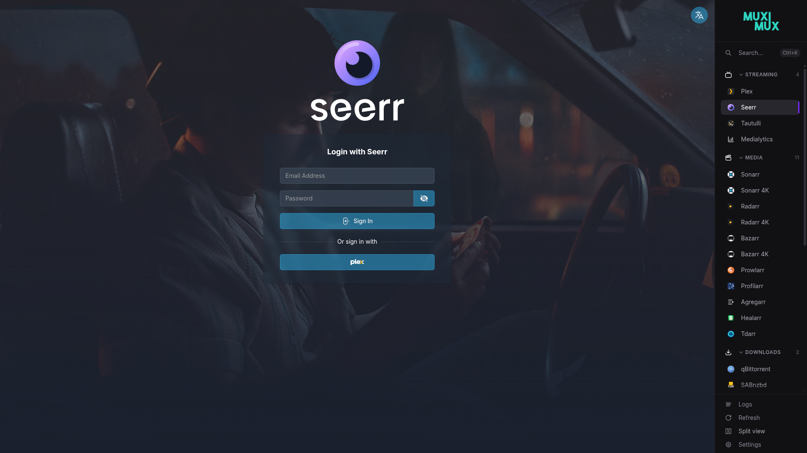
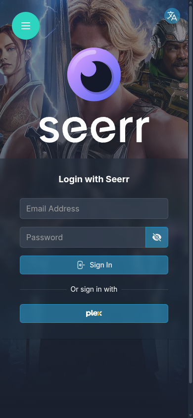
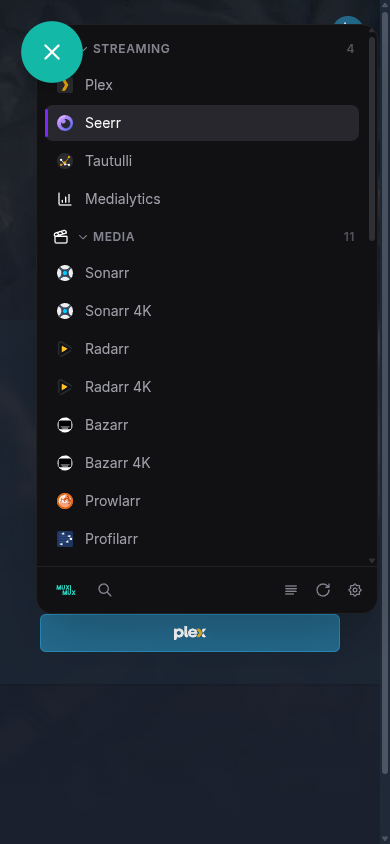

# Navigation

Muximux supports five navigation layouts. You can switch between them at any time in the Settings panel or by editing `config.yaml` directly.

## Navigation Positions

| Left Sidebar | Top Bar | Bottom Bar |
|:---:|:---:|:---:|
| [](https://raw.githubusercontent.com/mescon/Muximux/main/docs/screenshots/05-style.png) | [](https://raw.githubusercontent.com/mescon/Muximux/main/docs/screenshots/05a-style-top.png) | [](https://raw.githubusercontent.com/mescon/Muximux/main/docs/screenshots/05b-style-bottom.png) |

| Floating | Right Sidebar |
|:---:|:---:|
| [](https://raw.githubusercontent.com/mescon/Muximux/main/docs/screenshots/05c-style-floating.png) | [](https://raw.githubusercontent.com/mescon/Muximux/main/docs/screenshots/05d-style-right.png) |

### Top

Horizontal bar across the top of the screen. The bar shows apps as icons, with optional labels below. This layout works well on wide screens with many apps, because the full width is available for app icons.

### Left

Vertical sidebar on the left side of the screen. This is the classic dashboard layout. You can configure the sidebar width.

### Right

Vertical sidebar on the right side of the screen. It mirrors the left layout. Use it if you prefer navigation on the right.

### Bottom

Horizontal bar across the bottom of the screen. Same layout as the top bar, just anchored to the bottom edge.

### Floating

A floating action button (FAB) that opens a popover panel with your apps organized by group. This option gives your apps the most screen space, because nothing is visible until you tap the button. You can drag the FAB to any position on the screen. Each browser saves its location in localStorage (the browser's local storage for this site). The `floating_position` config option (bottom-right, bottom-left, top-right, top-left) sets the default corner for first-time visitors. Double-click the FAB to snap it back to its configured corner.

## Bar Style (Top/Bottom Only)

When using **top** or **bottom** navigation, you can choose between two bar styles:

### Grouped (default)

The bar puts apps under collapsible group headers. Each group has its own section, with the group name above its apps. This is the standard layout. It works well when you have many apps in distinct categories.

### Flat

All apps sit in a single continuous row. Small icon dividers separate the groups, instead of full headers. Each divider uses the group's configured icon. The result is more compact and dock-like. It suits you if you want to maximize horizontal space or prefer a cleaner look.

The dividers are buttons, not decoration. Hover over one to highlight that group's apps and dim the rest. Click one to scroll the bar to the start of that group. Flat mode has no collapsible sections. So the dividers are how you jump straight to a group when the row is longer than the window.

```yaml
navigation:
  position: top
  bar_style: flat    # grouped (default) or flat
```

The flat style only applies to top and bottom bars. Left, right, and floating navigation always use the grouped layout with collapsible sections.

## Pinned Apps

Grouped top and bottom bars put every app behind a dropdown. So opening an app takes two steps: open the group, then pick the app. Pinning lifts an app out of the dropdown. A pinned app gets its own button in the bar, ahead of the group dropdowns. It opens in one click. The app also stays listed in its group, so the group dropdown stays complete.

```
[ Plex ] [ Home Assistant ] | [ Media ▾ ] [ Monitoring ▾ ] [ Downloads ▾ ]
```

Muximux sorts pinned apps among themselves by their `order`. This is the same field that sorts them inside their group. Left, right and floating navigation have no dropdowns. There, pinned apps appear as a **Pinned** section above the groups. The flat bar style already shows every app directly, so pinning does not change it.

Pin an app from its edit form under **Display**, or in `config.yaml`:

```yaml
apps:
  - name: Plex
    url: http://plex.local:32400
    group: Media
    pinned: true
```

## Configuration

You can set all navigation settings in `config.yaml` under the `navigation` key:

```yaml
navigation:
  position: top              # top, left, right, bottom, floating
  width: 220px               # Sidebar width (for left/right/floating)
  auto_hide: false            # Hide navigation after inactivity
  auto_hide_delay: 0.5s       # Delay before hiding (when auto_hide is true)
  show_on_hover: true         # Show hidden nav on mouse hover
  show_labels: true           # Display app names under/beside icons
  show_logo: true             # Show Muximux logo in navigation
  show_home_button: true      # Show the home button (turning it off also turns off show_splash_on_startup)
  show_app_colors: true       # Tint app icons with their configured color
  show_icon_background: false # Show circular background behind icons
  show_splash_on_startup: false # Show splash screen on initial load
  show_shadow: true           # Add drop shadow to navigation bar
  dynamic_tab_branding: false # While an app is open, the browser tab shows its name and icon
  bar_style: grouped          # grouped or flat (top/bottom only)
  icon_scale: 1.0             # Scale factor for navigation icons (default: 1.0)
  floating_position: bottom-right # Default FAB corner (bottom-right, bottom-left, top-right, top-left); user can drag to any position
  hide_sidebar_footer: false  # Hide the footer section in left/right sidebars
  show_docker_badge: true     # Docker whale next to Docker-discovered apps (admins only)
```

## Docker Badge

`discovery.docker.health_badge_placement` can be `overview_and_nav`. Then apps found through Docker discovery show a Docker whale (and a container state pill) in the navigation. To hide the whale and keep a plainer sidebar, set `navigation.show_docker_badge: false` (Settings, General, "Show Docker Badge"). The setting also applies to the Docker status cluster on the overview page. The default is `true`.

- The whale is administrator information, so Muximux shows it only to admins. Other roles never see it, whatever the setting says.
- The setting changes the display only. It does not affect discovery, tracking, sync or the container state pill.
- To remove Docker chrome from the navigation altogether, set `health_badge_placement` to `overview` or `off`.

## Collapsed Sidebar

When `show_labels` is `false` on left or right sidebars, the sidebar collapses to a narrow icon strip. In this mode, the footer automatically becomes a drawer:

- A **cogwheel icon** appears at the bottom of the sidebar.
- **Hover** over it to expand the sidebar and reveal a drawer with all footer actions (Logs, Refresh, Split View, Sign Out, Settings) and their labels.
- The drawer closes when the mouse leaves the sidebar.

All controls stay reachable whether labels are visible or hidden.

## Split View Controls

The navigation bar has inline split view controls on all five positions. When split view is off, a single icon turns it on. When split view is on, the controls expand. They show an orientation toggle, panel selector arrows, and a close button, all in the existing button row.

See the [Split View](split-view.md) page for full documentation.

## Toggle Buttons

The **Overview** and **Logs** buttons in the navigation bar act as toggles. Clicking the logs button while viewing an app opens the log viewer. Clicking it again returns to the app you were viewing. The overview button works the same way: click to see the overview, click again to return to your app.

## Auto-Hide Behavior

When `auto_hide` is set to `true`:

- The navigation **starts collapsed on page load**. So it doesn't stay open until you happen to move the mouse over it and away again. (If your cursor is already over the navigation area when the page loads, the navigation shows immediately.)
- The navigation bar hides itself after `auto_hide_delay` with no mouse activity near the navigation area.
- Move your mouse to the navigation edge of the screen to show it again (when `show_on_hover` is `true`).
- The **floating** position always sits on top of the content, whether it is visible or not. The other positions (top, left, right, bottom) give their screen space back to your apps when the navigation is hidden.

If you toggle `auto_hide` in Settings during a session, the navigation you are using does not collapse. The start-collapsed behavior applies on the next page load.

## Mobile

On small screens (below 640px), Muximux automatically switches to the **floating** navigation, whatever your configured position is. A single floating button opens the full app list as a popover panel. The rest of the screen stays free for the app. On small screens the button defaults to the bottom-right corner, whatever `floating_position` says. If it covers an app's own controls, drag it somewhere else. The browser remembers where you left it, and that position wins over the default. Muximux keeps your configured position in settings. It takes effect again on wider screens.

| App open | Navigation open |
|---|---|
| [](https://raw.githubusercontent.com/mescon/Muximux/main/docs/screenshots/17-mobile.png) | [](https://raw.githubusercontent.com/mescon/Muximux/main/docs/screenshots/18-mobile-menu.png) |

The panel opens next to the button instead of filling the screen. So the button stays exactly where you pressed it. When the panel is closed, the button is the only Muximux element on screen.

Swipe left or right on the main content area to switch between apps.

## All Settings Are Live

You can change every navigation setting in the Settings panel, with an immediate preview. Changes take effect instantly, with no page reload or restart. So you can try different layouts and keep the one that suits your setup.
