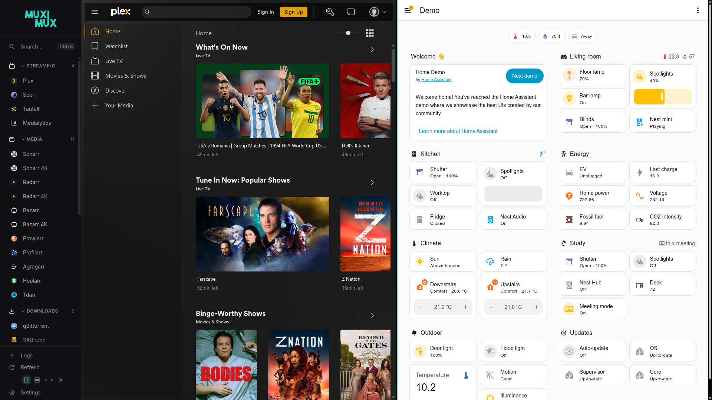
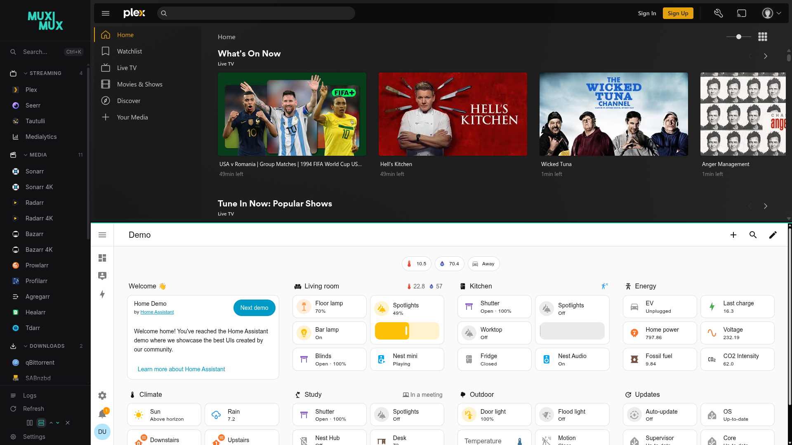

# Split View

Split view shows two apps in a single browser tab. The apps are side by side (horizontal) or stacked (vertical). Each panel is an independent iframe. A panel stays loaded when you switch focus. So you can monitor two services at once and not lose their state.

| Horizontal Split | Vertical Split |
|:---:|:---:|
|  |  |

## Enabling Split View

Click the split view icon in the navigation bar. Muximux turns on horizontal split by default and opens a second panel. The navigation controls expand to show orientation and panel selection options.

The split view controls appear inline in the navigation bar. This works in all five positions (top, left, right, bottom, floating).

### Controls

When split view is active, the navigation bar shows:

| Control | Description |
|---------|-------------|
| **Horizontal** | Two side-by-side columns icon. Click to switch to horizontal orientation. Highlighted when active. |
| **Vertical** | Two stacked rows icon. Click to switch to vertical orientation. |
| **Panel arrows** | Chevron arrows indicating which panel receives the next app selection. The active panel's arrow is highlighted with the accent color. |
| **Close** | X icon. Closes split view and keeps the active panel's app. |

### Selecting a Panel

The panel arrows in the navigation bar set which panel is the **target**. When you click an app in the navigation, it loads into the target panel. The arrows change with the current orientation:

- **Horizontal split:** Left (◀) and right (▶) arrows
- **Vertical split:** Up (▲) and down (▼) arrows

You can also click directly inside a panel to set it as the active target.

### Active Panel Indicator

The draggable divider between the panels shows a colored accent line on the edge of the active panel. This line shows the target panel. Nothing covers the iframe content.

## Draggable Divider

Drag the divider between the two panels to resize them. Double-click the divider to reset it to a 50/50 split. Muximux keeps the divider between 20% and 80%, so neither panel becomes too small.

## URL Hash Routing

The URL hash (the part after `#`) shows the split view state:

| URL | Result |
|-----|--------|
| `#sonarr` | Single view with Sonarr loaded |
| `#sonarr+radarr` | Split view with Sonarr in panel 1 and Radarr in panel 2 |
| `#sonarr+radarr?sonarr=%2Fseries%2Fx&radarr=%2Fmovie%2F1` | The same, with a page opened in each app (apps need [Allow deep links](apps.md#deep-links-in-links)) |

You can bookmark a split view configuration or share it as a link. When Muximux loads with a `+` in the hash, it enables horizontal split and loads both apps. Split view is not available on a screen narrower than 640px. On such a screen, the link opens only the first app.

## Switching Orientation

Click the horizontal or vertical icon to switch orientation while split view is active. Both panels keep their loaded apps. Only the layout direction changes.

## Closing Split View

Click the close (X) button in the split view controls. Muximux keeps the app in the active panel and discards the other panel. The view returns to single-panel mode.

## Configuration

Split view is a client-side feature with no configuration in `config.yaml`. It is available on all navigation positions and works with any combination of apps.

Split view is not available on mobile viewports (below 640px). On these screens, two panels do not fit well.
